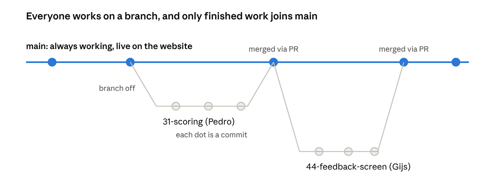
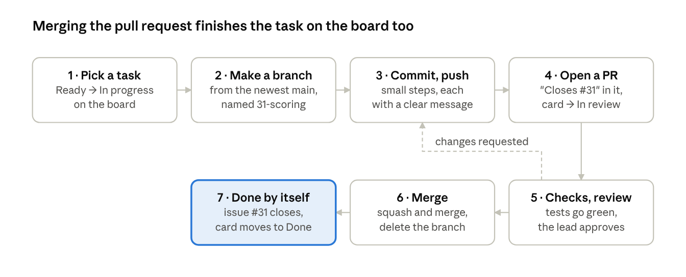

# How we work

Every task is a GitHub issue. Every change goes through a branch and a pull request into `main`. The board updates itself when the work is merged. This page explains each step for anyone who hasn't worked this way before.

Repository: [scamdle/app](https://github.com/scamdle/app) · Board: [Scamdle plan](https://github.com/orgs/scamdle/projects/1) · Plan: [plan.md](plan.md)

## The big picture

Three things work together: **Git** holds the code, **issues** describe the tasks, and the **project board** shows where each task stands. Pull requests are the bridge: merging one adds the code to `main` and closes its task.

| Thing | What it is | Where |
| --- | --- | --- |
| Git repository | The code plus its full history | [scamdle/app](https://github.com/scamdle/app), and a copy on each laptop |
| Branch | Your own parallel line of work, separate from `main` | On your laptop, pushed to GitHub |
| Pull request (PR) | A request to add your branch to `main`, with review and automatic checks | The repo's *Pull requests* tab |
| Issue | One task with a number, owner, labels and sprint | The repo's *Issues* tab |
| Project board | A view of all issues, one column per status | [Scamdle plan](https://github.com/orgs/scamdle/projects/1) |
| Workflow | A rule that moves cards on the board automatically | Board → ⋯ → *Workflows* |

## Git basics

Git saves your code in small steps and lets six people work at the same time without breaking each other's work. Five words cover most of it:

- **Repository (repo):** the project folder plus its complete history. There's one on GitHub, and everyone has a copy on their laptop (made with `git clone`).
- **Commit:** a save point with a short description, like "Add star calculation for red-flag exercises". Every commit stays in the history, so you can see who changed what and why, and go back if needed.
- **Branch:** your own parallel line of work. `main` is the official version: it always works and it's what runs on the website. You do your work on a branch and only add it to `main` when it's finished and reviewed.
- **Push:** send your commits from your laptop to GitHub, so others can see them.
- **Pull:** fetch everyone else's new commits from GitHub to your laptop.



Pedro and Gijs work in parallel without touching `main`. Each branch joins `main` only through a reviewed pull request, and Gijs's branch starts from the `main` that already has Pedro's work in it.

## Pull requests

A pull request (PR) says: *"I'd like to add my branch to `main`, please take a look."* Nothing reaches `main` without one. The PR page is where code gets checked, by people and by machines.

A PR page shows:

- **Every changed line:** red for removed, green for added.
- **The description:** what you did, why, and a line like `Closes #31` that links the PR to its task.
- **Automatic checks:** lint, type check, tests and the accessibility check run by themselves. A green tick means they passed. A red cross means something broke, and the PR can't be merged until it's fixed.
- **A preview link from Vercel:** the website exactly as it would look with this change. Designers and content owners can try it without installing anything.
- **Review:** a teammate reads the code and either approves it or leaves comments. You fix things on the same branch, push again, and the PR updates by itself.

**Who reviews:** Jasper for backend PRs, Gijs for frontend PRs. A lead's own PR is reviewed by the other lead. Content changes in the admin panel don't need a PR, because they go through the draft → review → published workflow there. Changes to the docs in this folder do go through a PR, reviewed by Jasper.

**Why we review:** mistakes are caught before they reach real users, at least two people understand every piece of code, and everyone learns from seeing how others solve things. A good review comment asks a question or explains a risk ("What happens if a message has 0 red flags?"). It's never about the person.

**Writing a good PR:** keep it small (a few days of work at most), give it a title that says what it does, and add a screenshot or the preview link for anything visual.

## Merging and merge conflicts

Merging adds a branch's commits to `main`. When the PR is approved and all checks are green, the author clicks **Merge**, then **Delete branch**. Vercel puts the new version live, and the linked issue closes by itself.

We use **Squash and merge**. All the small commits on the branch ("fix typo", "try again") become one tidy commit on `main`, named after the PR. That keeps the history of `main` readable.

**Merge conflicts.** If two people changed the *same lines* of the same file, Git can't decide which version is right. It marks the spot and asks you to choose:

```
<<<<<<< your branch
const maxStars = 3;
=======
const maxStars = 5;
>>>>>>> main
```

To fix it:

1. Get the newest `main` into your branch: `git pull origin main`.
2. Open each file Git lists, keep the right version, and delete the `<<<<<<<`, `=======` and `>>>>>>>` lines. VS Code shows buttons for this: *Accept current*, *Accept incoming*, *Accept both*.
3. Commit and push. The PR updates, and the conflict warning disappears.

Not sure which version is right? Ask the person who wrote the other one. That's always faster than guessing.

**How to avoid conflicts:** keep branches short (merge within a few days), pull `main` before starting new work, and say in the group chat when you're about to change a shared file such as the data model or the design tokens.

## Issues and the board

An issue is one task with a number, for example **#31 "W3 · Scoring module for all three engines"**. The board isn't a separate list: it shows those same issues, one column per status. Move a card and the issue's status changes. Close the issue and the card moves to Done.

**What an issue has**

- **Assignee:** who does it. One person per issue.
- **Labels:** area (`backend`, `frontend`, `design`, `content`, `research`, `testing`, `report`) and size (`size:S` up to 2 hours, `size:M` up to 5 hours).
- **Milestone:** the sprint it belongs to.
- **Week, Start and End:** fields on the board, used for the week view and the timeline.
- **Comments:** questions and decisions about the task. Ask in the issue, not in a private chat, so the answer stays with the task.

**The columns**

| Column | Means | Who moves it there, and when |
| --- | --- | --- |
| Backlog | Everything still to do, including later weeks. Can still be vague or blocked | New issues land here automatically |
| Ready | Clear, small enough, not blocked, and part of the current sprint. Can be started right now | Jasper, at sprint planning every second Friday |
| In progress | Someone is working on it | You, the moment you start |
| In review | A pull request is open and waiting for review | You, when you open the PR |
| Done | Merged or finished | Automatic when the issue closes |

Only take work from **Ready**. If a Ready task turns out to be unclear or blocked, comment on the issue and move it back to Backlog.

**Useful board views:** *My tasks* (filter `assignee:@me`) shows just your work. *By week* groups everything by the Week field. *Board* shows the five columns. Tasks that aren't code, like research, writing exercises or running a test session, are issues too: close them yourself when they're done, with a comment saying where the result is.

## Workflows

Workflows are rules on the board: *when this happens, set the status to that*. They mean nobody has to drag cards to Done by hand. The key chain is: **PR with `Closes #31` merged → GitHub closes issue #31 → the board moves #31 to Done.**

| Workflow | What it does | Our setting |
| --- | --- | --- |
| Auto-add to project | New issues and PRs in the repo appear on the board | Filter `is:issue,pr` in `scamdle/app` |
| Item added to project | New items get a starting column | Status → Backlog |
| Item closed | A closed issue moves to the last column | Status → Done |
| Pull request merged | A merged PR moves to Done | Status → Done |
| Item reopened | A reopened issue comes back | Status → In progress |
| Auto-archive items | Old finished cards leave the board, so it stays readable | Closed more than 14 days ago |

**What stays manual, on purpose:** Backlog → Ready is a planning decision, and Ready → In progress is a person saying "I'm on it". Those are choices, not events, so no rule makes them.

**The magic words** that close an issue when a PR is merged: `Closes #31`, `Fixes #31` or `Resolves #31` in the PR description. For several issues, write one per line.

## One task from start to finish

Pedro picks up **#31: Scoring module**. Steps 1–6 are his. Step 7 happens by itself.



If the review asks for changes, Pedro goes back to step 3 on the same branch. The PR updates automatically, so nothing has to be reopened.

**The commands**

1. **Pick the task.** On the board, drag #31 from *Ready* to *In progress*.
2. **Make a branch** from the newest `main`:

   ```
   git checkout main
   git pull
   git checkout -b 31-scoring
   ```

3. **Work, and commit in small steps.** `git add .` stages all changed files. The commit saves them with a message:

   ```
   git add .
   git commit -m "Add star calculation for red-flag exercises"
   ```

   Then push the branch to GitHub. `-u origin` is only needed the first time:

   ```
   git push -u origin 31-scoring
   ```

4. **Open the PR.** GitHub shows a *Compare & pull request* button. Write what you did and add `Closes #31`. Drag the card to *In review*.
5. **Checks and review.** Wait for the green tick. Answer review comments, fix things, then `git add`, `git commit` and `git push` again.
6. **Merge.** After approval, click *Squash and merge*, then *Delete branch*.
7. **Done.** Issue #31 closes and the card moves to *Done*. Next time anyone starts a task, `git pull` on `main` gives them Pedro's work.

**Useful extras:** `git status` shows which branch you're on and what changed. `git log --oneline` shows the recent commits. In VS Code, the *Source Control* panel does all of this with buttons.

## Team rules

1. **Never work directly on `main`.** Always use a branch. `main` is protected, so GitHub won't let you push to it anyway.
2. **One branch per issue,** named with its number and a few words: `31-scoring`, `44-feedback-screen`.
3. **Keep PRs small,** a few days of work at most. Small PRs get reviewed quickly and rarely conflict.
4. **Always write `Closes #<number>`** in the PR description, so the board updates itself.
5. **Pull `main` before starting** a new branch.
6. **Review within one working day.** A PR waiting for days blocks its author and invites conflicts.
7. **Ask in the issue,** not in a private chat, so the answer stays with the task.
8. **Update your cards:** move a card to *In progress* when you start, and to *In review* when you open the PR.

## Setting up (once)

1. Accept the invitation to the `scamdle` organisation (check your email or github.com/orgs/scamdle).
2. Install [Git](https://git-scm.com/downloads) and [VS Code](https://code.visualstudio.com). VS Code has a built-in panel for branches, commits and conflicts, so you don't need the terminal for everything.
3. Tell Git who you are, and get the code:

   ```
   git config --global user.name "Your Name"
   git config --global user.email "you@example.com"
   git clone https://github.com/scamdle/app.git
   cd app
   ```

## The first practice PR (week 2)

Before real work starts, everyone does the full cycle once on something harmless:

- [ ] Make a branch called `practice-<yourname>`
- [ ] Add your name and role to the team list in `README.md`, then commit and push
- [ ] Open a PR with `Closes #1` in the description, and ask a teammate to review it
- [ ] Merge it after approval, delete the branch, and watch the card move

It takes about 15 minutes. Every merge conflict on `README.md` along the way is good practice, not a problem.
