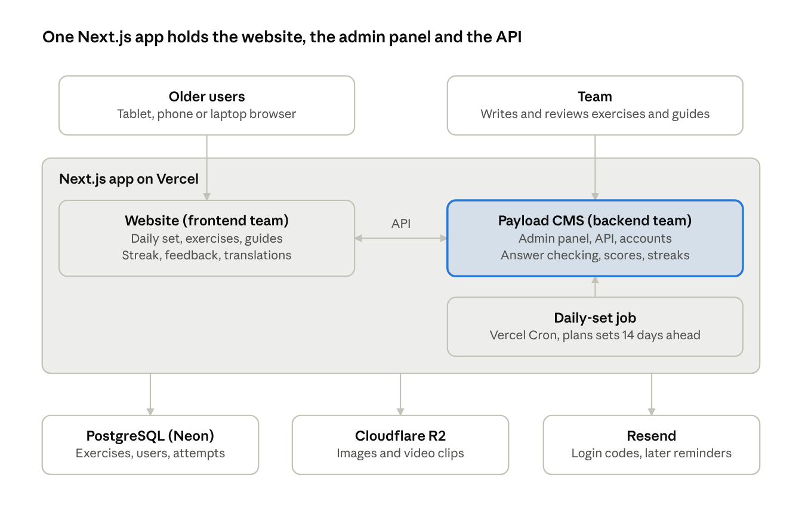
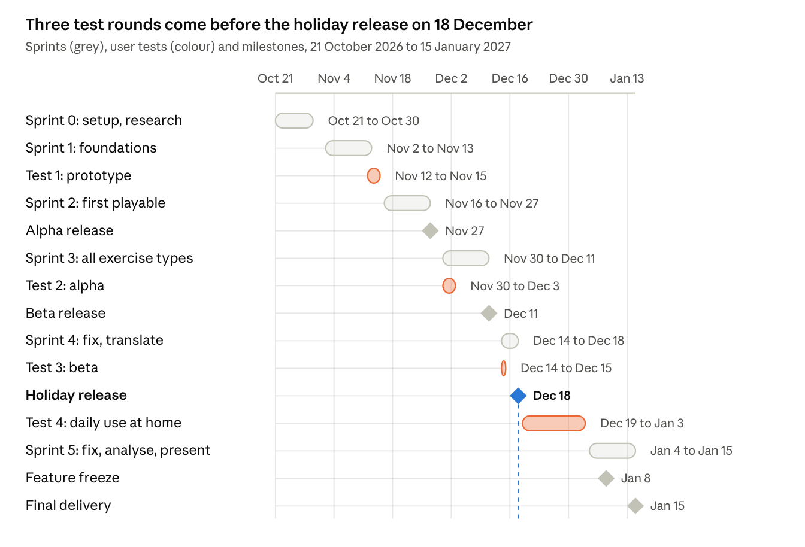

# Scam Trainer: Software Development Plan

*Started 21 October 2026. This file is the living version of the plan: change it through a pull request like any other file.*

**Contents:** [Overview](#overview) · [Target group](#target-group) · [Scope](#scope-and-requirements) · [Exercises](#exercises-categories-formats-and-scam-types) · [Persona](#the-persona-anna) · [Logic](#how-the-logic-works) · [Scoring](#scoring) · [Guides](#guides-and-lessons) · [Tech stack](#tech-stack-and-architecture) · [Team](#team-and-responsibilities) · [Schedule](#schedule-and-milestones) · [Way of working](#way-of-working-and-task-tracking) · [Research](#research-plan) · [Testing](#testing-plan) · [Idea board](#idea-board-after-version-1) · [Risks](#risks) · [Open questions](#open-questions)

## Overview

Scam Trainer is a Wordle-style website where older people do three short scam-spotting exercises every day, each from a different category. By 15 January 2027 we deliver a working product that real older people (our relatives) have used daily for two weeks.

Why daily: older people can forget things faster, so a small routine keeps what they learn fresh. Repeating a little often works better than a one-off workshop.

| Item | Decision |
| --- | --- |
| Context | Graded course project by six Erasmus students |
| Deadline | Final delivery and presentation around 15 January 2027 |
| Languages | English first. Then Estonian, Dutch, German and Portuguese so each member's relatives can test it |
| Budget | Small: about €10–20 for a domain. Everything else on free tiers |
| Capacity | 6 people × ~5 h/week × ~10 working weeks ≈ **300 hours** in total |

The capacity number drives every scope decision in this plan. 300 hours is enough for a solid version 1, but not for every idea, so extras go to the idea board.

## Target group

The main users are people aged about 65 and over who already use email, a smartphone or a tablet, and maybe online banking, but didn't grow up with it. A second group matters just as much: the adult children and grandchildren who introduce the app to them and help them get started.

What this means for the product:

- **Eyesight and motor skills:** large text (at least 18px), high contrast, large tap targets, nothing that depends on precise clicking.
- **Confidence:** some users are afraid of "doing something wrong" online. The tone is calm and encouraging, with no timers and no shaming for wrong answers.
- **Devices:** mostly tablets and phones, some laptops. It has to work well on all three in the browser, with no app install.
- **Language:** many don't read English comfortably, so translation into the testers' languages is required for the user tests.
- **Country:** scams are local. Smart-ID exists in Estonia, itsme in Belgium, DigiD in the Netherlands, Chave Móvel Digital in Portugal. Exercises can have country variants.

Example users to design for:

| Persona | Situation | What they need |
| --- | --- | --- |
| Maria, 74, Portugal | Uses WhatsApp on a tablet to talk to her grandchildren. Has had "Hi mum, new number" messages. | Simple chat exercises, Portuguese text, big buttons |
| Peter, 68, Germany | Does online banking on a laptop and gets a lot of fake bank emails. | Email and link exercises, explanations he can apply in his inbox |
| Aino, 71, Estonia | Uses Smart-ID daily for her bank and the state portal. | Practise telling real Smart-ID requests from fake ones |
| Tom, 42, Netherlands (helper) | Worries about his father and wants him to practise. | Quick to explain, no complicated sign-up |

## Scope and requirements

Version 1 (15 January) covers the daily set, all four exercise formats, the guides, and optional accounts. Everything else waits for the idea board. The list is sorted with MoSCoW: Must, Should, Could, Won't (for now).

| Priority | Requirement |
| --- | --- |
| Must | A daily set of 3 exercises, each from a different category, the same for everyone |
| Must | Persona card: Anna, the fictional person every exercise is addressed to |
| Must | Engine: spot the red flags (scam or real, then tap the suspicious parts) for emails, links, messages and screens |
| Must | Engine: real or fake for email addresses, AI-made images and videos, and ID-app screens |
| Must | Engine: what would you do next? (multiple-choice situations, one or two steps) |
| Must | Stars per exercise (0–3) and feedback after every exercise: what was right, what was missed, and why |
| Must | Guides: how to tell real from fake, for the exercises and for real life |
| Must | Guest play with the streak saved on the device |
| Must | Admin panel where the team adds and reviews exercises and guides without coding |
| Must | Accessible on tablet, phone and laptop (WCAG 2.2 AA) |
| Should | Optional account (email code, no password) to keep the streak across devices |
| Should | Translations into Estonian, Dutch, German and Portuguese for the user tests |
| Should | Weekly overview of stars per category, and statistics on which exercises fool people most |
| Could | Daily reminder email |
| Could | Share your result with family, Wordle-style |
| Could | "Help, I've been scammed" page with contacts per country |
| Won't (now) | Native mobile app, personal or adaptive exercises, read-aloud, AI-generated exercises, leaderboards |

The three Could items are on the idea board. We only build them if the Musts and Shoulds are done before the holiday release on 18 December.

## Exercises: categories, formats and scam types

There are five categories and three ways of answering (engines). Each daily set has three different categories and uses at least two different engines. Both teams build each engine once and reuse it in every category.

**Three exercise engines**

1. **Spot the red flags.** Two steps. First the user decides: *scam or real?* If they say scam, they tap every part that gave it away, like using "inspect element" on it. Each tappable part is either a red flag or a safe part, and each one carries an explanation.
2. **Real or fake.** The user sees 2–3 items (email addresses, images, videos, Smart-ID screens) and picks the fake one, or judges a single item as real or fake.
3. **What would you do next?** A short situation ("You get this text…", "Your 'grandson' calls and says…"), and the user picks the best next action from 3–4 choices. A situation can have a second step where the scammer reacts ("The caller says the bank is closed, so call this number instead").

**Five categories**

| Category | What the user practises | Engines | Example |
| --- | --- | --- | --- |
| Email | Phishing emails and sender addresses | Red flags, Real or fake, What next | "Your account is blocked" email from lumobank-veilig.com |
| Links | Reading a web address | Red flags, What next | lumobank.com.secure-login.net/verify |
| Messages and calls | SMS, WhatsApp and phone call scams | Red flags, What next | "Hi Grandma, this is Max, new number, I need money urgently" |
| Fake screens | Pop-ups, fake login pages, digital ID requests | Red flags, Real or fake, What next | A Smart-ID PIN request Anna didn't start, a "Your computer is infected" pop-up |
| AI media | AI-made photos and videos | Real or fake | A video of a celebrity promoting a crypto investment |

**Not everything is a scam.** About one in three items is real, for example a genuine message from Anna's bank about her new card. Users should learn to *check*, not to distrust everything. A real message gives full stars to whoever recognises it as real.

**Scam tactics as tags.** Every red flag gets a tag for the tactic behind it, so feedback and statistics can talk about tactics and not just single exercises:

- Pretending to be someone else (bank, government, family member)
- Creating urgency ("within 24 hours")
- Playing on fear or excitement (threats, prizes, love)
- Asking for unusual payment (gift cards, crypto, "safe account" transfers)
- Asking for codes or personal data (PIN, Smart-ID PIN, passwords)
- Suspicious sender or link

**The five financial scams that target older people most** (from our notes, to be checked in the research phase). Each one becomes a series of exercises:

| Scam | What scammers want | Biggest warning sign | Category in the app |
| --- | --- | --- | --- |
| Grandparent | Money | A family emergency | Messages |
| Tech support | Remote access to the computer | A pop-up warning | Fake screens |
| Government | Personal information | Threats (fines, arrest) | Email, Messages |
| Romance | Money | An emotional online relationship | Messages |
| Investment | Cryptocurrency | Guaranteed returns | AI media, Messages |

As a rule of thumb, a version 1 exercise takes 2 minutes or less, so the whole daily set takes about 5 minutes.

## The persona: Anna

Every exercise happens to the same fictional person, Anna. Because users know her life, they can check whether a message is really meant for her. That's the most important question in real life too: *is this actually for me?* One persona works in every country and language, and we never need users' private data.

**Anna's card** (always one tap away during an exercise: "Who is Anna?")

| About Anna | Details |
| --- | --- |
| Who | Anna Berg, 72, retired teacher, lives alone in a small town |
| Phone and email | Android phone, number ending in 48 21. Email anna.berg@lumomail.com |
| Bank | Lumo Bank only. Uses the Lumo Bank app. Got a new bank card last month |
| Digital ID | Uses her country's ID app (Smart-ID in Estonia, itsme in Belgium, DigiD in the Netherlands, Chave Móvel Digital in Portugal, the ID card app in Germany) |
| Family | Daughter Laura (46). Grandson Max (19), who studies abroad. Both numbers are saved in her phone |
| This week | Ordered garden gloves online on Monday. SwiftParcel delivers them on Thursday |
| Services | Electricity from Brightwatt, a laptop with Windows, a TV streaming subscription |
| Doesn't have | A car, any investments or crypto, accounts at other banks. She never entered a lottery |

**How exercises use her.** Every exercise starts with "Anna receives this…". The user checks the message against her card:

- Is it addressed to *her* (her name, email, number), or to "Dear customer"?
- Does she actually use this bank, shop or service?
- Was she expecting it? A parcel she ordered, a login she started herself?
- Does it match her family? Max's real number is saved, so "Hi Grandma, new number" is suspicious.

| Message | Is it for Anna? |
| --- | --- |
| "Your Volta Bank account is blocked" | No. She only banks with Lumo Bank |
| "Unpaid parking fine for your car" | No. She has no car |
| A Smart-ID PIN request on Tuesday evening | No. She didn't start a login |
| SwiftParcel on Thursday: "Your parcel arrives today", link to swiftparcel.com | Probably real: she ordered something and the address matches. Check the link anyway |

**From the game to real life.** The last guide asks users to make *their own* card on paper: their banks, the services they use, their family's numbers. That way the habit moves from Anna to their own phone. The card stays on paper, so we store nothing.

All companies and domains (Lumo Bank, SwiftParcel, Brightwatt, lumomail.com) are fictional. In week 2 we check that none of them is a real company or a registered domain.

## How the logic works

Everyone gets the same three exercises per calendar day. The server picks them in advance, checks the answers, and keeps the streak.

**Picking the daily set** (a scheduled job, once a day)

1. Fill the schedule 14 days ahead, so there is always a buffer and the team can see what's coming.
2. For each new day, choose 3 *different* categories with at least two different engines, rotating so no category is skipped more than 2 days in a row.
3. In each category, pick a published exercise that hasn't been used in the last 30 days, preferring the least used.
4. Save it as a `DailySet` (date → 3 exercises). An admin can swap any exercise by hand.
5. If a category runs out of unused exercises, the job alerts the team. That's our signal to make more content.

**The day boundary.** "Today" is the user's local date. Portugal is UTC+0 and Estonia UTC+2, so the browser sends its local date and the server returns that day's set.

**Country variants.** A few exercises (such as digital ID requests) have a variant per country: Smart-ID for Estonia, itsme for Belgium, DigiD for the Netherlands, and so on. The daily set stays the same for everyone, and each user sees their own country's variant.

**Playing and scoring**

- The server checks every answer, not the browser. We save each attempt (exercise, answer, stars, time taken). This is our research data: which scams and tactics fool people most.
- After each exercise, the feedback screen shows what was right, what was missed and why, and links to the matching guide. The star rules are under [Scoring](#scoring) below.

**Streaks**

- A day counts when all 3 exercises are *finished*, right or wrong. We reward the routine, not perfection.
- Missing a day resets the streak, but kindly ("Welcome back!"). There's no guilt messaging.

**Accounts**

- *Guest (default):* progress and streak are stored on the device. Nothing to sign up for.
- *Optional account:* the user enters their email, gets a 6-digit code and types it in. No password to forget. Guest progress is merged into the account. A code works better than a magic link because older users often read their email on a different device from the one they play on.
- We store as little as possible: an email address, language, country and progress. That keeps GDPR simple.

**Content workflow**

Draft → In review → Published. Whoever writes an exercise can't approve it: a second team member checks the facts, the explanations and the translation. Only published exercises can be picked for a daily set. Later, AI can draft exercises, but they go through the same review.

**Main data model**

| Entity | Key fields |
| --- | --- |
| Exercise | category, engine, country (or all), difficulty, content per language, parts (each: red flag yes/no, tactic tag, explanation), related guide, status, author |
| DailySet | date, 3 exercises |
| Guide | category, title, body per language, linked exercises |
| User | email, language, country, reminder opt-in (later) |
| Attempt | user or guest id, exercise, date, answer, score, seconds taken |

### Scoring

Each exercise earns 0–3 stars, so a day has at most 9. Stars reward spotting scams *and* recognising real messages. The streak rewards showing up. Stars never affect the streak, and there's no leaderboard.

| Engine | 3 stars | 2 stars | 1 star | 0 stars |
| --- | --- | --- | --- | --- |
| Spot the red flags, scam message | Said "scam", red-flag score 90% or more | Said "scam", 50–89% | Said "scam", under 50% | Said "real" |
| Spot the red flags, real message | Said "real" | — | — | Said "scam" |
| Real or fake, one question | Correct | — | — | Wrong |
| Real or fake, three items | 3 correct | 2 correct | 1 correct | 0 correct |
| What would you do next? | Best action | Safe but not the best | Risky | Dangerous |

**Red-flag score.** Wrong taps count half against you. Guessing by tapping everything doesn't pay, but one mistake doesn't ruin the exercise either.

```math
\text{red-flag score} = \frac{\text{red flags found} - 0.5 \times \text{safe parts tapped}}{\text{total red flags}}
```

Example: an email with 5 red flags. The user finds 4 and taps 1 safe part. (4 − 0.5) ÷ 5 = 70%, so 2 stars.

**What would you do next?** Every choice is labelled best, safe, risky or dangerous, with an explanation. Example: a text from "Lumo Bank" says there was a suspicious login and asks Anna to call a number.

| Choice | Rating | Stars | Why |
| --- | --- | --- | --- |
| Call Lumo Bank on the number on the back of her card | Best | 3 | She checks with the real bank, using a number she already trusts |
| Delete the message and do nothing | Safe | 2 | She's safe, but if it were real she'd miss it. Checking is better |
| Reply "Is this really Lumo Bank?" | Risky | 1 | The scammer will say yes, and now knows her number is active |
| Call the number in the message | Dangerous | 0 | That number goes straight to the scammer |

In a two-step situation, the exercise gets the *lower* of the two steps' stars. In real life one dangerous step is enough to lose money.

**What the user sees**

- Right after an exercise: the stars, a kind sentence (3 stars: "Well spotted!", 0 stars: "A tricky one. Here's what gave it away."), and the explanation of every part.
- After the daily set: today's stars out of 9 and the streak.
- Weekly overview: stars per category over the last 7 days. The weakest category is highlighted, with a link to its guide.

The scoring rules live in one shared server module with a unit test for every row of the tables above.

## Guides and lessons

The guides do two jobs. They help with the exercises, and they work on their own as a reference users can open when a real message looks suspicious. Every exercise links to one guide, and every guide links back to practice exercises.

**Three golden rules** (shown on the home page and at the end of every guide)

1. **Never decide straight away.** Hang up or close the message, then call the real company on the number you already know (from your card, a letter or their official website).
2. **Never transfer money "to keep it safe".** No bank, police officer or government will ever ask for that.
3. **Call your family first.** Ask "Is this normal?" A real company will wait. A scammer won't want you to check.

**Version 1 guides**

| Guide | Teaches | Linked category |
| --- | --- | --- |
| How to check who sent an email | Display name vs real address, look-alike domains | Email |
| Reading a web address | Finding the real domain, https is not proof, shortened links | Links |
| The "Hi mum" message and other chat scams | New numbers, urgency, asking for money via chat | Messages |
| Real or fake: digital ID requests (Smart-ID, itsme, DigiD…) | Only confirm what you started yourself, never share PIN codes | Fake screens |
| Fake virus warnings and tech support | Real companies don't show pop-ups with phone numbers, never give remote access | Fake screens |
| Spotting AI-made photos and videos | Hands, text, lighting, lip sync, too-good-to-be-true celebrity ads | AI media |
| What your bank and government will never ask | PIN, passwords, transfers to a "safe account" | All |
| I clicked or paid, now what? | Call your bank right away, change passwords, report to the police | All |

**Writing style:** short sentences, one idea per paragraph, a real-looking example screenshot in each guide, and no jargon ("web address", not "URL"). Each guide takes no more than 5 minutes to read.

## Tech stack and architecture

The whole product is TypeScript in one Next.js project with Payload CMS built in, hosted on Vercel. One language and one deployment keep 300 hours focused on the product, not on gluing systems together. Payload also gives us an admin panel, accounts, media uploads and an API without building them ourselves.

| Layer | Choice | Why | Cost |
| --- | --- | --- | --- |
| Frontend | Next.js (App Router), TypeScript, Tailwind CSS | Fast on older tablets and phones, huge community, one language for the whole team | Free |
| Accessible components | React Aria | Keyboard, screen-reader and focus behaviour done right | Free |
| Translations | next-intl (interface) and Payload localization (content) | Every text and exercise per language, with English as the fallback | Free |
| CMS, API, accounts | Payload CMS 3 | Lives inside Next.js. Admin panel, email-code login, media and API out of the box | Free (open source) |
| Database | PostgreSQL on Neon | Reliable, and Payload supports it directly | Free tier |
| Media | Cloudflare R2 | Images and short videos with no download fees | Free tier |
| Email | Resend | Login codes now, reminders later | Free tier |
| Hosting and daily job | Vercel with Vercel Cron | Preview link for every pull request. A once-a-day job is enough for the daily set | Free (Hobby plan) |
| Testing | Vitest, Playwright, axe-core | Unit, end-to-end and accessibility checks in GitHub Actions | Free |
| Design | Figma | Shared designs and a clickable prototype | Free (education plan) |
| Code and tasks | GitHub: repository, Projects, Actions | Code, board and automatic checks in one place | Free |
| Domain | e.g. a .com or .eu | A real address makes testers trust it more | About €10–15 a year |



Both teams work in the same repository. The frontend team builds the pages and the exercise engines. The backend team builds the Payload collections, the API, the scoring and the daily-set job. TypeScript types generated from Payload keep the two sides in sync.

## Team and responsibilities

Jasper leads the project and the backend, and Gijs leads the frontend. Besides their code area, every member also owns one content category, one translation and their own user testers.

| Member | Code area | Owns | Content category | Translation and testers |
| --- | --- | --- | --- | --- |
| Jasper (project + backend lead) | Backend | Architecture, Payload setup and data model, daily-set job, deployment, backend code review, project board | Fake screens (Smart-ID) | Estonian |
| Hendrik | Backend | Accounts and email codes, guest-to-account merge, streaks and progress API, reminder email (if time) | Email | Dutch or French (to confirm) |
| Pedro | Backend | Answer checking and scoring, attempts and statistics, seed data and content import, test setup and CI | Links | Portuguese |
| Gijs (frontend lead) | Frontend | Design system, layout, accessibility, translations setup, frontend code review | AI media | Dutch |
| Hugo | Frontend | The "spot the red flags" engine and the email, link, chat and screen renderers | Messages | Estonian (shared with Jasper) |
| Marlon | Frontend | The "real or fake" and "what would you do next?" engines, home and daily set screen, streak screen, guides pages | Guides (lead editor) | German |

**What content ownership means:** writing about 9 exercises in your category for the holiday release (≈ 45 in total, enough for 14 days without repeats) and more after it, reviewing someone else's category, and doing the research for it.

**Leads:** Jasper and Gijs review pull requests in their area and decide when the two areas disagree. Jasper keeps the board and the schedule, and runs the meetings.

## Schedule and milestones

There are six sprints and four test rounds. Each round tests a more complete version, so by the holidays the product has been tested and revised three times. The holiday release on 18 December is the one hard date: everyone is home with family and can test in person.



Each sprint ends with a demo of what works. If a sprint slips, we cut scope inside the sprint and keep the dates.

| Sprint | Done at the end of the sprint | User test | Content target |
| --- | --- | --- | --- |
| 0 · Setup and research | Repository, board, Vercel and Payload running. Exercise format agreed. First draft of Anna. Research split up | — | — |
| 1 · Foundations | Research notes. Figma design and clickable prototype. Data model, scoring module, daily-set job (first version) | Test 1: prototype, 12–15 Nov | 10 draft exercises |
| 2 · First playable | Red-flag engine (email, links), what-next engine, stars, guest streak, live daily set. **Alpha release 27 Nov** | — | 25 exercises, 3 guides |
| 3 · All exercise types | Fixes from test 2. Chat and fake-screen exercises, real-or-fake engine, guides pages, accounts, translations setup. **Beta release 11 Dec** | Test 2: alpha, 30 Nov – 3 Dec | About 40 exercises, 7 guides |
| 4 · Fix and translate | Fixes from test 3. Translations, device checks, holiday test kit. **Holiday release 18 Dec** | Test 3: beta, 14–15 Dec | About 45 exercises, all 8 guides, translated |
| Holidays | One member on call each week for bugs | Test 4: daily use, 19 Dec – 3 Jan | — |
| 5 · Fix, analyse, present | Survey and data analysis, fixes, feature freeze 8 Jan, report and final presentation | Survey, 4–8 Jan | — |

The week-by-week tasks for every person are issues on the [Scamdle plan board](https://github.com/orgs/scamdle/projects/1). Group the board by *Week* to see them in the same order as the schedule.

## Way of working and task tracking

We work in two-week sprints and track every task as a GitHub issue on one GitHub Projects board, linked to the code that closes it.

New to branches, pull requests and boards? [How we work](how-we-work.md) explains every step, with one task worked through from start to finish.

**The board**

- Columns: Backlog → Ready → In progress → In review → Done.
- Every task is an issue with an owner, a size (S ≤ 2 h, M ≤ 5 h, L = split it up) and labels: `backend`, `frontend`, `design`, `content`, `research`, `testing`, `report`.
- Every sprint is a GitHub milestone, so the board shows sprint progress at a glance.
- Content (exercises, guides) is tracked as issues too, so the board shows the real workload and not just the code.

**Meetings** (kept small: at 5 h/week, meetings eat into build time)

| When | What | Length |
| --- | --- | --- |
| Every Monday | Weekly sync: what's done, what's next, blockers | 30 min |
| Wednesday and Friday | Written check-in in the group chat (three lines each) | 5 min |
| Every second Friday | Sprint review (demo what works) and planning (fill the next sprint) | 60 min |

**Code rules**

- `main` is protected. All work happens on a branch and goes in through a pull request with one approving review (from the area lead, or the other lead for their own PRs).
- Every pull request gets an automatic preview deployment on Vercel, so designers and content owners can check changes without running code.
- The automatic checks (lint, type check, tests, accessibility check) must pass before merging.

**Definition of done:** the code is merged, the checks pass, it works on a tablet and a phone, the texts can be translated, and the issue is closed with a screenshot or a preview link.

## Research plan

Research runs in sprints 0 and 1, until 13 November. Each content owner researches their own category, and each member also researches their own country. The output is a short research note per category in `docs/research/`, plus a folder of real (anonymised) scam examples.

**Questions to answer**

1. Which scams hit older people most *right now*, per country and per channel (email, SMS, WhatsApp, phone, social media)?
2. Which red flags appear in each, and which tactics are behind them?
3. What do older users struggle with online (reading, tapping, trust, jargon)?
4. What do official sources tell people to do, so our guides agree with the police and the banks?

**Methods**

- **Desk research:** official reports and warning pages (below). Recent warning pages are the best source for realistic exercises.
- **Collect real examples:** ask relatives to forward or screenshot suspicious messages they've received. Remove names and numbers before saving. This is our most realistic content.
- **Short interviews:** 15 minutes with 1–2 older relatives each: what have you received, what made you suspicious, what confuses you online?

The first finding already supports our top-5 list. In the FBI's 2025 report, investment fraud caused the biggest losses among people over 60, followed by tech support scams and romance scams ([AARP summary](https://www.aarp.org/money/scams-fraud/fbi-ftc-report-2025-losses.html)).

**Sources to start with**

| Source | Country | Why it's useful |
| --- | --- | --- |
| [FTC: Protecting Older Consumers 2024–2025](https://www.ftc.gov/system/files/ftc_gov/pdf/P144400-OlderAdultsReportDec2025.pdf) | US | Yearly report on which scams cost people over 60 the most |
| [FBI IC3 2025 report on seniors (AARP summary)](https://www.aarp.org/money/scams-fraud/fbi-ftc-report-2025-losses.html) | US | Losses per scam type for people over 60, including AI-related scams |
| [Europol and EBF #CyberScams campaign](https://ebf.eu/ebf-media-centre/cyberscamspressrelease) | EU | The 7 most common financial scams, with material in 27 languages |
| [itvaatlik.ee (RIA)](https://www.itvaatlik.ee) and RIA's monthly [cyber situation reports](https://www.ria.ee/sites/default/files/documents/2024-12/Situation-in-cyberspace-november-2024.pdf) | Estonia | Common Estonian scams, Smart-ID and bank phishing waves |
| [Verbraucherzentrale Phishing-Radar](https://www.verbraucherzentrale.nrw/phishing-radar) | Germany | Weekly list of real phishing emails with screenshots |
| Safeonweb.be (Centre for Cybersecurity Belgium) | Belgium | Current warnings, including itsme-related scams |
| Fraudehelpdesk.nl | Netherlands | Current scams reported by the public, DigiD and "Hi mum" messages |
| CNCS (Centro Nacional de Cibersegurança) and Banco de Portugal | Portugal | Official warnings, Chave Móvel Digital and MB WAY scams |
| [W3C: Older Users and Web Accessibility](https://www.w3.org/wai/older-users/) | — | Which accessibility needs come with ageing, and how WCAG covers them |
| Your own bank's security page | Each | Real examples of what the bank will and won't ask |

The linked pages were found in a search on 21 October 2026. The unlinked ones are starting points we still need to check.

## Testing plan

We test on four levels: automatic checks on every change, a second-person review of all content, device checks before each release, and four rounds with older users. Three of those rounds happen before the holidays, so the version relatives use over Christmas has already been tested and improved.

**1. Automatic tests (run on every pull request)**

- *Unit tests (Vitest):* daily-set picking (3 different categories, no repeats within 30 days), scoring, streak rules, time zones (Lisbon vs Tallinn around midnight).
- *End-to-end tests (Playwright):* a guest finishes a full daily set. A user logs in with a code and keeps their streak. An admin publishes an exercise.
- *Accessibility (axe):* no serious problems allowed, plus a Lighthouse accessibility score of at least 95.

**2. Content review.** Every exercise and guide is checked by someone other than the author. Are the facts right? Is every red flag explained? Does it avoid real brand names and logos? Does the translation read naturally?

**3. Device checks** before each release: an iPad, an Android phone, an iPhone and a Windows laptop. Also with the browser zoomed to 200% and with the system's large-text setting on.

**4. User tests with older people.** Each round tests a more complete version, and its findings go straight into the next sprint. We use the same testers every round so we can see them improve. Each member runs sessions with 1 relative over a video call, and Hugo and Marlon organise 1–2 local sessions in our Erasmus city (through a senior centre, a library or the university's international office).

| Round | When | What they test | Who and how | What we learn |
| --- | --- | --- | --- | --- |
| 1. Prototype | 12–15 Nov | Clickable Figma prototype: home, one red-flag exercise, feedback, Anna's card | 6 relatives on video calls with screen sharing, plus 1 local session. Three tasks, thinking aloud | Does the idea make sense? Is the text readable and are the buttons clear? |
| 2. Alpha | 30 Nov – 3 Dec | First real version: red flags (email, links), what would you do next, stars and streak. English, with the member translating aloud | The same relatives on video, plus 1–2 local sessions. They use their own device. We note time, errors and the usability score | Usability of the real product. Fixes go into sprint 3 |
| 3. Beta | 14–15 Dec | All three engines, all five categories, first translations | The same relatives, a short 20-minute call | Are the round 2 problems fixed? Do the new formats work? |
| 4. Holidays | 19 Dec – 3 Jan | Holiday release: translated, about 45 exercises | The same relatives in person: a guided first session at home, then 2 weeks of daily use on their own | Does the routine stick? Do their stars improve from week 1 to week 2? |
| Afterwards | 4–8 Jan | — | All testers: the System Usability Scale (10 standard questions) plus 3 open questions | Usability score in round 4 compared with round 2 (aim: 70 or more) |

**Before testing:** a one-page consent form in each language (what we collect, that it's anonymous, that they can stop at any time), and a shared notes template so all six members record results the same way.

**Success criteria for January:** testers complete at least 10 of the 14 days. Average scores in week 2 are higher than in week 1. No tester needs help to finish a daily set after day 1.

## Idea board (after version 1)

These are good ideas that don't fit in 300 hours. We keep them as `idea` issues on the board and pick from them once the Musts are done, or leave them for the next team.

| Idea | Why it's valuable | Effort |
| --- | --- | --- |
| Daily reminder email | Supports the routine for people who forget | S |
| Share your result with family | Wordle-style result without spoilers. Gets families talking | S |
| "Help, I've been scammed" page | What to do right now, with bank and police contacts per country | S |
| AI-drafted exercises with human review | More content faster once we have enough good examples | M |
| Practice mode | Unlimited extra exercises in the categories you find hardest | M |
| Phone call and voice-clone exercises | Listen to a call and judge it, since grandparent scams increasingly use cloned voices | L |
| QR code scams ("quishing") | Fake QR codes on parking meters and letters | M |
| Family dashboard | A relative can see (with permission) that their parent is practising | L |
| Read aloud | Text-to-speech for people with poor eyesight | M |
| Printable cheat sheet | The three golden rules on a card for the fridge or next to the phone | S |
| Seasonal exercises | Tax season, parcel scams before Christmas, energy bills in winter | S |

## Risks

The biggest risk is not the code. It's making 45 good exercises in five languages alongside everything else.

| Risk | What could happen | What we do about it |
| --- | --- | --- |
| Content takes longer than expected | Not enough exercises for a 14-day test | Content is on the board from sprint 1. Each owner makes 4 exercises per sprint. The daily-set job warns when a category runs low |
| Too much scope for 300 hours | Half-finished features at the deadline | Strict MoSCoW. Feature freeze on 8 January. Ideas go on the idea board, not into the sprint |
| Translation workload | Four extra languages × 45 exercises × 8 guides | Machine-translate first, then each member proofreads their own language. Only what testers will see |
| Holiday release slips past 18 December | No time for the Christmas tests, and the core of the project is lost | 18 December is the one hard date. If needed we cut a category, never the test |
| Real brands in fake emails | Trademark problems, or our screenshot reused as a real scam | Only made-up companies ("Lumo Bank"), every exercise marked as practice, links lead nowhere |
| AI images and videos | Hard to source, licensing unclear, and AI gets better fast | Real photos from Unsplash or Pexels (free licence). Generate AI ones ourselves. Record the source of every file |
| Privacy of testers | GDPR problems with test data | Minimal data, consent forms, no names in research notes, data deleted after the project |
| Team availability over the holidays | Members are away or offline in late December | The test runs on its own after the guided session. Only one person needs to be on call for bugs |
| Erasmus ends | Nobody maintains it after the semester | A good README, a handover note, and the code in a shared GitHub organisation |

## Open questions

- [ ] What is the exact final deadline and presentation date? Are there course milestones before it?
- [ ] Which documents does the course want handed in (report, process documentation, user test results)?
- [ ] Does Hendrik's family read Dutch or French? That decides the Belgian translation.
- [ ] The product name and domain. "Scam Trainer" is a working title, and the GitHub organisation is called "scamdle".
- [ ] Does the teacher need access to the GitHub board and the repository?
- [ ] Do we need the school's or an ethics board's approval to run tests with older people?
- [ ] Is there a school contact or partner (a bank, the police, a senior centre) who could check our guides or give us extra testers?
